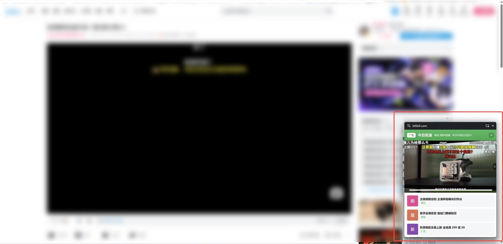
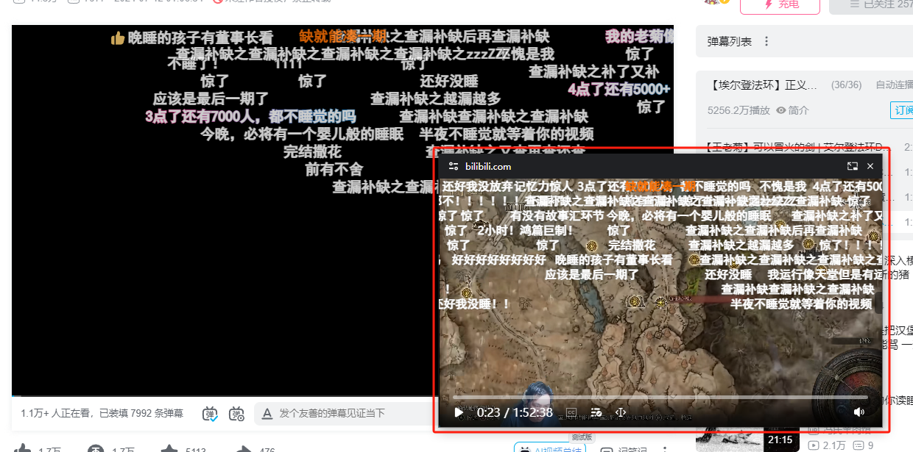

# 小窗视频助手（dmMiniPlayer 修改版）

> ## ⚠️ 修改版声明（必读）
> - 本仓库是 **[apades/dmMiniPlayer](https://github.com/apades/dmMiniPlayer)** 的**个人修改版**，非官方版本，与原作者 apades 无任何关联，也未获得其背书或授权关系。
> - **许可协议**：Creative Commons Attribution-NonCommercial 4.0 International（**CC BY-NC 4.0**）。本仓库全部代码（含本修改版新增内容）均以 CC BY-NC 4.0 发布，**禁止任何商业使用**（包括但不限于售卖、收费下载、用于商业产品导流等）。仓库根目录的 `LICENSE` 文件为协议全文，请勿删除或替换。
> - **与原版差异**：
>   - 画中画悬浮窗**顶部新增伪装栏目条**（绿色渐变、含"广告"标识与关闭按钮）；
>   - 悬浮窗**底部新增竖向排列的信息卡片**；
>   - 扩展**改名**为「小窗视频助手」并更换为绿色主题图标；
>   - 弹幕渲染层让位，避免遮挡顶部栏目条；
>   - 所有伪装内容均为**静态展示**，点击无任何跳转或交互。
> - 以上修改为**个人非商业用途**的外观调整，不改变原项目核心播放/弹幕逻辑。

## 🖼️ 效果预览

> 下图为**本修改版**的实际运行截图，重点看画中画悬浮窗顶部与底部新增的伪装外壳。

   
  <i>悬浮窗特写：顶部绿色伪装的「今日优选」栏目条（带“广告”标识、可关闭），底部三张竖向信息卡片</i>

   
  <i>整体效果：悬浮窗固定在网页右下角，远看与普通资讯推送条无异（截图背景已做模糊处理）</i>

- 最上方的 `bilibili.com` 来源栏是浏览器强制显示的安全栏，**任何扩展都无法隐藏**。
- 伪装内容全部为静态文本，点击不跳转、不发起任何网络请求。

## 浏览器支持

本扩展依赖 **Document Picture-in-Picture（Doc PiP）API**，仅桌面浏览器支持：

| 浏览器（桌面） | 是否可用 |
|---|---|
| Chrome ≥ 116 / Edge ≥ 116 | ✅ |
| Brave / Vivaldi / Arc / Opera ≥ 102 | ✅（Chromium 内核） |
| Firefox ≥ 151（2026-05 起） | ⚠️ 理论上支持，未经实测，需 `about:debugging` 临时加载 |
| Safari（macOS/iOS） | ❌ 不支持 Doc PiP |
| 所有手机浏览器 | ❌ Doc PiP 为桌面专属 |

> 不支持 Doc PiP 的环境（Safari、手机浏览器）下，弹幕与伪装外壳均不可用，最多回退为原生视频画中画。

## 安装方式

### Chrome / Edge / 其他 Chromium 浏览器（推荐）
1. 打开 `chrome://extensions`（或 `edge://extensions`）。
2. 右上角开启「**开发者模式**」。
3. 点击「**加载已解压的扩展程序**」，选择本项目 `dist/` 目录。
4. 回到视频网站使用画中画按钮即可。

### Firefox（桌面，较新版本，**未在本项目实测**）
上游 manifest 使用 Chromium 专属的 `world: "MAIN"` 内容脚本与 `service_worker.type: "module"`，
Firefox 未必能按此清单正常加载。此处仅保留上游的安装路径供参考，**请以 Chrome / Edge 实测为准**。
1. 打开 `about:debugging` → 「此 Firefox」。
2. 「**临时加载附加组件**」→ 选择 `dist/manifest.json`。
3. 临时加载每次重启浏览器需重新加载。

### CRX 包
可自行用 Chrome 的「打包扩展程序」生成 `.crx`。注意：
- **不要把签名私钥（`.pem`）放进仓库或分发给任何人**——私钥一旦泄露，别人可签发与你扩展 ID 完全相同的包。
- Chrome 137+ 对非商店 CRX 安装限制较严，建议优先用「加载已解压的扩展程序」。

## 已知限制
- 画中画悬浮窗顶部的来源栏（如 `bilibili.com`）是浏览器强制显示的安全栏，**任何浏览器都无法隐藏**。
- 同一浏览器同时只能存在一个画中画窗口；关闭或刷新原视频标签页，悬浮窗会随之关闭。
- 悬浮窗内不支持全屏。

---

## 原项目说明（以下为 apades/dmMiniPlayer 原文，版权归原作者所有）

# 弹幕画中画播放器

 

支持最新的画中画API功能，可以播放、发送弹幕，支持字幕，键盘控制进度，更好的画中画播放体验的浏览器插件

- [chrome商店](https://chrome.google.com/webstore/detail/%E5%BC%B9%E5%B9%95%E7%94%BB%E4%B8%AD%E7%94%BB%E6%92%AD%E6%94%BE%E5%99%A8/nahbabjlllhocabmecfjmcblchhpoclj)
- [edge商店](https://microsoftedge.microsoft.com/addons/detail/hohfhljppjpiemblilibldgppjpclfbl)
- [FAQ](https://github.com/apades/dmMiniPlayer/wiki/FAQ)

如果你有什么问题或者功能提议，请到[issues](https://github.com/apades/dmMiniPlayer/issues)里提出

## 🚀 功能
- 在画中画窗口中拖动、键盘控制进度、调整音量，调节倍速
- 弹幕播放和发送
  - bilibili视频 + 直播
  - 斗鱼直播
  - CC直播
  - 动画疯
  - youtube直播 *
  - twitch直播 *
  - 抖音直播 *
- 支持bilibili、youtube的视频自带的字幕播放
- 支持bilibili、youtube的视频播放侧边栏，可直接在画中画里切换播放列表、推荐视频
- 支持外挂.xml .ass弹幕文件，下载可以使用[Bilibili-Evolved](https://github.com/the1812/Bilibili-Evolved)或[ACG助手](https://chromewebstore.google.com/detail/kpbnombpnpcffllnianjibmpadjolanh)，也可以通过输入bilibili url的下载弹幕并播放
- 支持外挂.srt .ass字幕
- 与bilibili一样的长按右键倍速功能
- 所有https网站下的视频画中画模式

> [!NOTE]
> *标记为目前只有监听网页弹幕DOM模式，可能会有意料之外的问题

## 📚 主要实现方法
### 旧版本PIP
用一个单独canvas画video + 弹幕，再把canvas的stream附加到一个单独的video上，最后开启画中画功能

### 新版本docPIP
使用了[documentPictureInPicture](https://developer.chrome.com/docs/web-platform/document-picture-in-picture/)该API，关于[技术细节在这](https://github.com/apades/dmMiniPlayer/wiki/tech%E2%80%90zh)

> [!NOTE]
> 该API是[非w3c草案功能](https://wicg.github.io/document-picture-in-picture/)，从chrome 116开始已经强推到stable上了，[非chromium](https://caniuse.com/?search=document-picture-in-picture)目前还没看到能用的，所以其他内核浏览器不打算支持
> 
> 如果你是360 qq浏览器这种套壳Chromium的且没有该API，地址栏到`chrome://flags/#document-picture-in-picture-api`查看是否支持开启

> [!WARNING]
> 如果你使用edge打开有红色tab栏，建议升级到`126.0.2592.102`版本以上

## 💖 引用代码
非常感谢这些项目的开源，让我抄了不少代码节省了很多时间

- [bilibili-evaolved](https://github.com/the1812/Bilibili-Evolved)
- [douyu-monitor](https://github.com/qianjiachun/douyu-monitor)
- [real-url](https://github.com/wbt5/real-url/blob/master/danmu/danmu/cc.py)
- [bilibili-API-collect](https://github.com/SocialSisterYi/bilibili-API-collect)
- [rc-slider](http://github.com/react-component/slider)
- [js-cookie](https://github.com/js-cookie/js-cookie)
- [esbuild-plugin-inline-import](https://github.com/claviska/esbuild-plugin-inline-import)
- [tsup](https://github.com/egoist/tsup/blob/796fc5030f68f929fecde7c94732e9a586ba7508/src/esbuild/postcss.ts)

## 🍔 投喂
如果您很喜欢这个项目, 欢迎打赏, 金额随意. 您的支持是我的动力(=・ω・=)

[爱发电](https://afdian.com/a/apades)

---

*本说明仅为协助合规使用，不构成法律意见。如对许可理解有疑问，请查阅 `LICENSE` 原文或咨询专业人士。*
